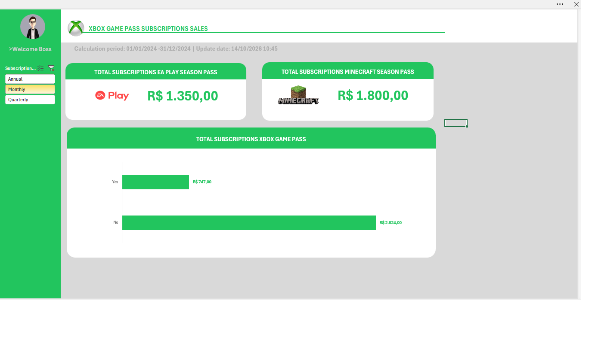
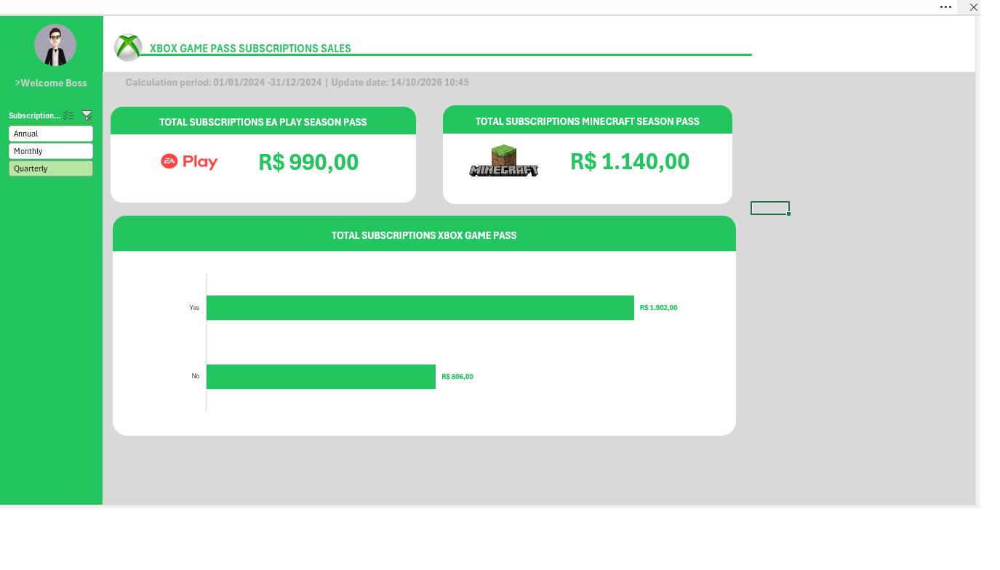
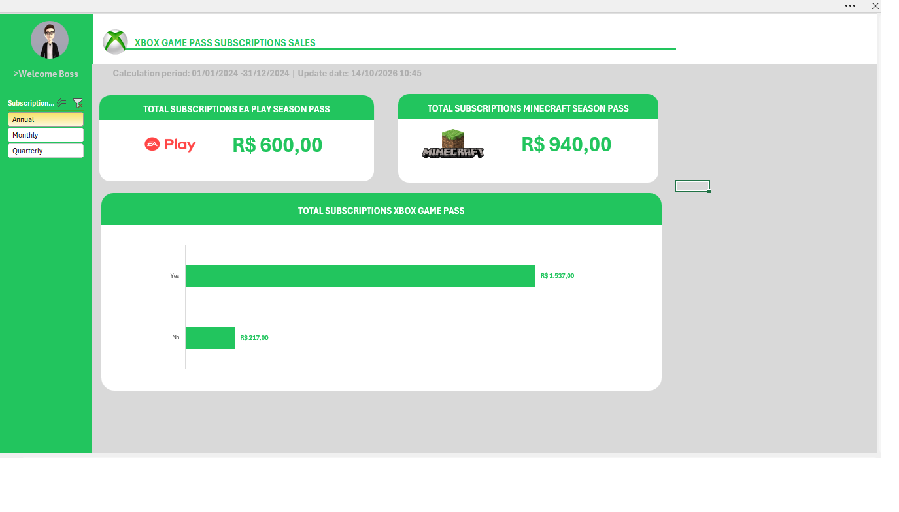

# Dashboard de Vendas — Xbox Game Pass | Excel

## 📊 Sobre o projeto

Este projeto foi desenvolvido como parte de um desafio prático da **DIO (Digital Innovation One)**, com o objetivo de transformar dados brutos de assinaturas em informações visuais que facilitem a análise do desempenho de vendas.

O dashboard foi construído no Microsoft Excel utilizando recursos de organização de dados, tabelas dinâmicas, segmentação de dados, indicadores e gráficos.

A proposta é demonstrar como uma base de dados pode ser estruturada e apresentada de forma visual para apoiar a interpretação dos resultados e a tomada de decisões.

## 🎯 Objetivos

- Organizar e analisar dados de assinaturas do Xbox Game Pass.
- Consolidar valores de vendas por tipo de assinatura.
- Comparar os resultados conforme a existência de renovação automática.
- Analisar as vendas de EA Play Season Pass e Minecraft Season Pass.
- Criar um dashboard interativo para facilitar a exploração dos indicadores.

## 🗂️ Base de dados

O projeto utiliza a base de assinaturas disponibilizada nos materiais de apoio do desafio.

Entre os campos utilizados estão:

- Identificação e nome do assinante;
- Plano contratado;
- Data de início da assinatura;
- Renovação automática;
- Preço da assinatura;
- Tipo de assinatura: mensal, anual ou trimestral;
- Adesão e valores dos serviços adicionais EA Play e Minecraft;
- Valores totais associados às assinaturas.

A base utilizada tem finalidade didática e serve como fonte para as análises apresentadas no dashboard.

## 📈 Indicadores apresentados

O dashboard contempla três frentes principais de análise:

**1. Total de vendas do Xbox Game Pass**

Consolidação dos valores das assinaturas conforme o tipo selecionado no filtro.

**2. Vendas por renovação automática**

Comparação entre assinaturas com renovação automática e assinaturas sem renovação automática.

**3. Vendas de serviços adicionais**

Apresentação dos valores associados ao EA Play Season Pass e ao Minecraft Season Pass.

## 🧮 Recursos do Excel utilizados

- Tabelas dinâmicas para resumir e agrupar os dados;
- Segmentação de dados (*Slicer*) para filtrar os resultados;
- Gráfico vinculado à análise dos dados;
- Indicadores visuais para destacar valores relevantes;
- Referências entre células de cálculo e elementos visuais;
- Organização das abas para separar a visualização, os cálculos e a base de dados.

## 🖥️ Estrutura da pasta de trabalho

O arquivo Excel está organizado em quatro abas:

- **Dashboard:** painel principal de visualização dos indicadores.
- **Bases:** dados de origem utilizados na análise.
- **Cálculos:** tabelas dinâmicas e resultados que alimentam os indicadores.
- **Assets:** recursos visuais e referências utilizados na composição do dashboard.

As abas de apoio ficam ocultas para manter o foco na visualização principal.

## 🔎 Como utilizar

1. Baixe o arquivo Excel disponibilizado neste repositório.
2. Abra a pasta de trabalho no Microsoft Excel para desktop.
3. Acesse a aba **Dashboard**.
4. Utilize a segmentação de dados **Subscription Type** para selecionar o tipo de assinatura desejado.
5. Observe a atualização dos indicadores e gráficos conforme o filtro selecionado.

A versão disponibilizada inicia com o filtro de assinaturas anuais (*Annual*).

Para atualizar as análises após alterações na base, utilize o recurso **Dados → Atualizar Tudo** no Excel.

> **Compatibilidade:** recomenda-se utilizar uma versão do Microsoft Excel compatível com tabelas dinâmicas, gráficos dinâmicos e segmentações de dados. Outros editores de planilhas podem apresentar diferenças de compatibilidade ou comportamento.

## 📚 Aprendizados

O desenvolvimento deste projeto permitiu praticar a organização de bases de dados, a construção de tabelas dinâmicas, a utilização de filtros interativos e a criação de indicadores visuais para apoiar análises de vendas.

O exercício reforça a importância de transformar dados em informações claras, organizadas e úteis para a tomada de decisões.

## ⚠️ Observação

Este projeto tem finalidade educacional e foi desenvolvido para atender ao desafio proposto pela DIO. Os resultados refletem a base de dados e os filtros utilizados na pasta de trabalho.
## 📊 Demonstração do Dashboard

O dashboard permite analisar os dados de vendas em três perspectivas temporais: mensal, trimestral e anual. A seleção do período atualiza os indicadores e gráficos, facilitando a interpretação dos resultados.

### Monthly — Visão Mensal

### Quarterly — Visão Trimestral

### Annual — Visão Anual

## 👨‍💻 Autor

**Ivan Moyses Ramos**

Projeto desenvolvido durante a formação prática na DIO.
